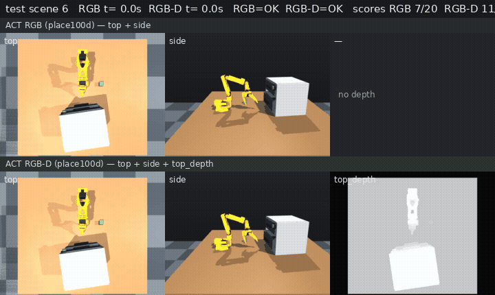

# 延续 RAX 开抽屉：用轨迹做数据，深度提高 ACT 成功率
> After the RAX drawer: scale the data, and depth lifts ACT

**语言 / Language:** [中文](#中文) · [English](#english)

> 系列上文：[RAX 开抽屉放方块](../so101-simstudio-rax-drawer/README.md)（冻结程序，保密测试 15/20）  
> 对照表与复现：[DEPTH_ABLATION.md](https://github.com/rocPAI-Forge/so101-simstudio/blob/main/labs/rax_drawer/vla/DEPTH_ABLATION.md) · [PIPELINE.md](https://github.com/rocPAI-Forge/so101-simstudio/blob/main/labs/rax_drawer/vla/PIPELINE.md) · [PR #27](https://github.com/rocPAI-Forge/so101-simstudio/pull/27) · 标签 `release-v0.1.6`

**图 1.** 同一保密场景（test scene 6）上，ACT RGB（无深度）与 ACT RGB-D（多一路俯视深度）的闭环对照。画面上的总分是保密测试 **7/20** 与 **11/20**。

---

## 中文

### 上一篇之后：把程序滚成数据集

[上一篇](../so101-simstudio-rax-drawer/README.md)借鉴 RAX 的想法，在 SO-101 仿真里写成一段固定程序：拉开抽屉、放进绿方块、再关上。程序不读抽屉关节和方块真实坐标，靠关节、相机和俯视深度。保密测试 **15/20**。代码是自己写的，没有用官方 RAX 工具链。

这一篇是那条线的延续，也是往**数据规模**走的一步。不再改控制器，而是用已经冻结的程序在仿真里滚成功轨迹，收成一份长程任务数据集，再拿去训练。采集目标约 **100** 条成功示范（`place100d`），任务就是这一整段：开抽屉 → 放方块 → 关抽屉。

深度在探索、编译这段轨迹时已经是关键：彩色能认出把手和绿方块，带尺度的俯视深度才用来量远近、决定往哪拉、往把手里面放多深。数据集把这一路深度留下来。

### 同一批数据，比深度有没有用

`place100d` 按 **LeRobot** 数据集来存。仓库里的 LeRobot（0.6.0 这一线）把俯视度量深度收成额外相机 `camera_top_depth`（3 通道灰度），ACT 可以直接训练。RGB 对照在训练时丢掉这一路，示范、步数和评测场景都不变。

| | explore10 | 保密 test20 |
| --- | --- | --- |
| ACT RGB（无深度） | 4/10（40%） | 7/20（35%） |
| ACT RGB-D（加俯视深度） | **6/10（60%）** | **11/20（55%）** |

两个划分都是 **+20 个百分点**。训练是 ACT 30k steps、batch 64（MI300X / ROCm）；闭环评测在 halo 上，状态用 6 维关节。

学出来的 **11/20** 仍低于手写程序的 **15/20**。这次能说的是：在同一批 RAX 轨迹、同一套 ACT 上，加上俯视深度，成功率提高得很清楚。深度目前是给现有图像骨干吃的灰度图，场景数量也不大。

数据和权重在 Hugging Face： [数据集](https://huggingface.co/datasets/alexhegit/so101-simstudio-rax-drawer-place100d) · [ACT RGB](https://huggingface.co/alexhegit/so101-simstudio-rax-drawer-act-rgb-place100d) · [ACT RGB-D](https://huggingface.co/alexhegit/so101-simstudio-rax-drawer-act-rgbd-place100d)。

---

## English

### After the last note: roll the program into a dataset

The [previous note](../so101-simstudio-rax-drawer/README.md) borrowed the RAX idea and kept a fixed program for open → place the green cube → close. The program does not read the drawer joint or the cube’s true pose. It uses joints, cameras, and overhead depth. Locked test: **15/20**. The code is ours; the official RAX toolchain was not used.

This note continues that line, and it is a step in **data scale**. The controller stays frozen. The program rolls out successful sim trajectories, and those become a long-horizon set for training. The collection target is about **100** successes (`place100d`) of the full skill: open, place, close.

Depth already mattered while that trajectory was explored and compiled. Color finds the handle and the green cube. Metric overhead depth measures distance: which way to pull, and how far inside the handle to place. The dataset keeps that depth stream.

### Same data, with and without depth

`place100d` is a **LeRobot** dataset. The LeRobot line in this repo (0.6.0) stores metric overhead depth as an extra camera, `camera_top_depth` (3-channel gray), so ACT can train on it. The RGB run drops that camera at train time. Demos, step budget, and eval scenes stay the same.

| | explore10 | locked test20 |
| --- | --- | --- |
| ACT RGB (no depth) | 4/10 (40%) | 7/20 (35%) |
| ACT RGB-D (+ overhead depth) | **6/10 (60%)** | **11/20 (55%)** |

Both splits move by **+20 percentage points**. Training is ACT for 30k steps, batch 64 (MI300X / ROCm). Closed-loop eval runs on halo with 6-D joint state.

The learned **11/20** is still below the scripted program’s **15/20**. What this comparison supports: on the same RAX trajectories and the same ACT recipe, overhead depth raises the success rate clearly. Depth here is gray frames for the existing image backbone, and the scene count is small.

Hub: [dataset](https://huggingface.co/datasets/alexhegit/so101-simstudio-rax-drawer-place100d) · [ACT RGB](https://huggingface.co/alexhegit/so101-simstudio-rax-drawer-act-rgb-place100d) · [ACT RGB-D](https://huggingface.co/alexhegit/so101-simstudio-rax-drawer-act-rgbd-place100d).
