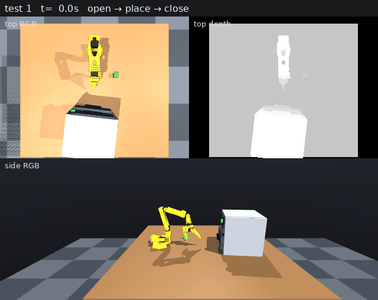
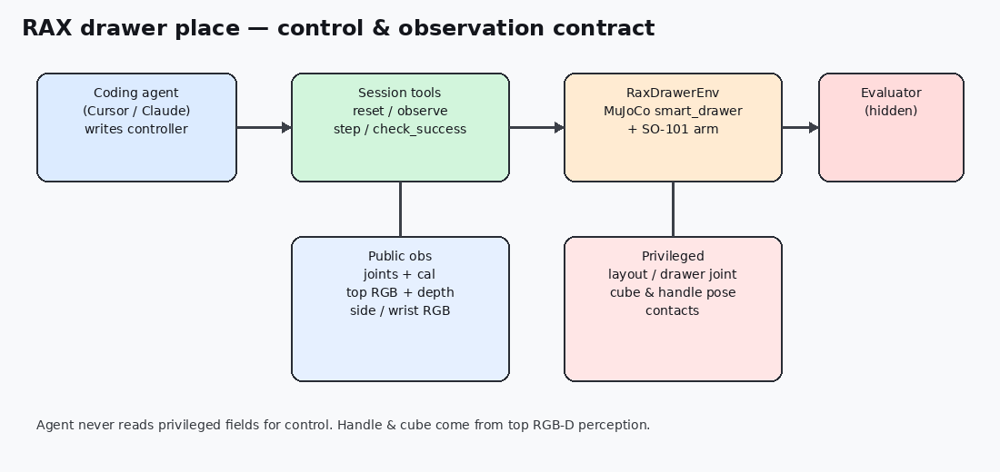
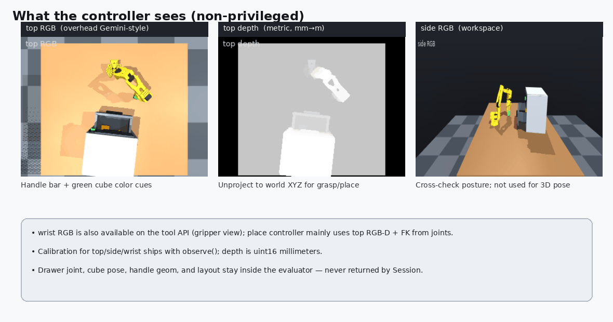
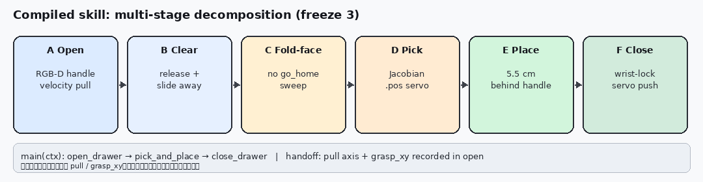
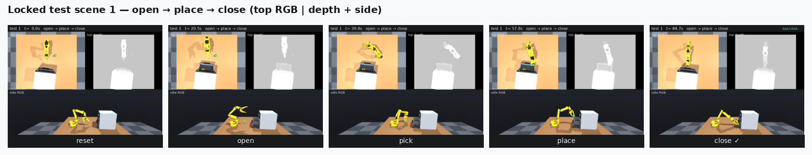
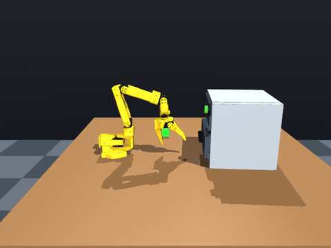
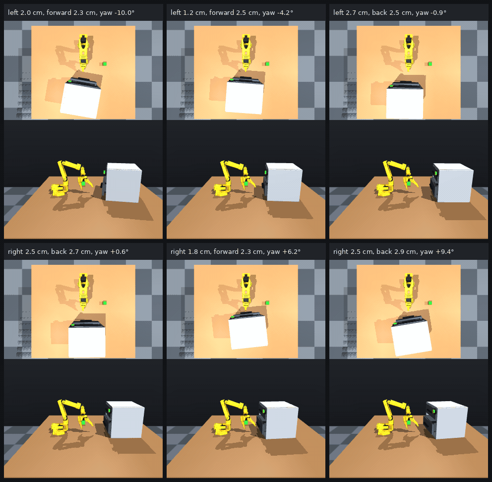
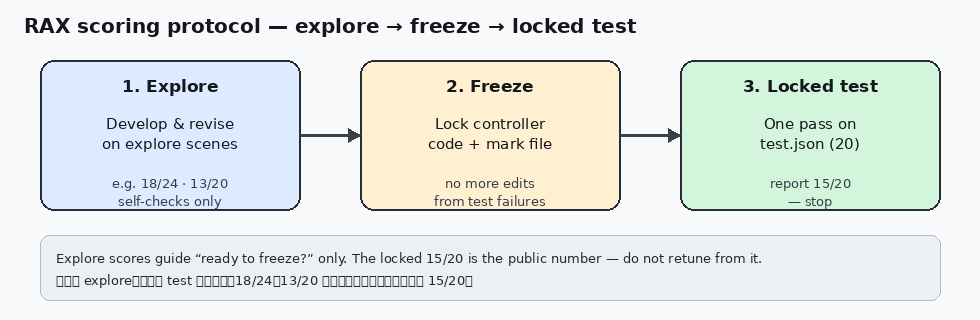

# RAX 开抽屉放方块：SO-101 SimStudio 上的非特权 Agent 控制

> RAX Drawer Place: Non-Privileged Agent Control on SO-101 SimStudio

**语言 / Language:** [中文](#中文) · [English](#english) · 📄 技术详解版 / Deep-dive

> ⚡ 只想快速了解？ → [**精简版 / Concise digest**](README.md)

> TL;DR：以 [RAX](https://arxiv.org/abs/2610.22496)（*Scaling Online Exploration for Robot Agents*）为理论框架，在 [SO-101 SimStudio](https://github.com/rocPAI-Forge/so101-simstudio) **`main`** 的 `labs/rax_drawer/` 上落地：**工具 API → 编译控制器 → freeze → 一次锁定评测**，完成开抽屉 → 放绿方块 → 关抽屉。公开观测含顶视 **度量深度**。锁定：**开合 16/20**，**place 15/20**（freeze 3）。方法说明：[RAX_METHOD.md](https://github.com/rocPAI-Forge/so101-simstudio/blob/main/labs/rax_drawer/rax_place/RAX_METHOD.md)。

> 系列上文：[项目介绍](../so101-simstudio/README-details.md) · [Lab 01 抓取放置](../so101-simstudio-lab01-pnp/README-details.md)  
> 论文：[arXiv:2610.22496](https://arxiv.org/abs/2610.22496) · [project](https://robot-agent-exploration.com)



*文首录像（锁定测试场景 1）：上排左俯视彩色、右俯视深度，下侧视。程序用彩色+深度找把手和方块；侧视主要给人看动作。 / Full-episode clip (locked test scene 1): overhead color | depth on top, side view below.*

---

## 中文

### 0. RAX 方法、意义，以及为何做这个案例

机器人学习近年靠**缩放示范数据与模型容量**（VLA / WAM 等）进展很大，但换一个本体或任务，通常仍要重新采 teleop；学到的策略也被示范分布束缚，难在交互中自我发现与组合新技能。Huang 等人提出的 **RAX（Robot Agent eXploration）** 把主轴换成 **缩放在线探索**：冻结参数的通用编码 Agent 经感知与控制 API 试任务，把成功决策**编译**成封装感知—规划—控制的可执行程序，并用持久记忆（笔记、已验证技能）跨 episode / 任务复用。论文报告：仿真五套基准相对强基线平均约 **+37.4**；真机可零示范掌握铰接、高精度、可变形与长程移动操作等；新本体只需接 API，而不必先采示范再训策略。

**相对 teleop 的优势（针对本任务）**

1. **前置成本**：开→放→关 全序列示范贵且难覆盖失败恢复；RAX 用探索预算换程序。  
2. **长程组合**：开、抓、放、关可分段试错再合成；IL 要对齐整条轨迹分布。  
3. **可解释交付**：产出是可读 Python，便于工程审阅与定点修补，而非只调 checkpoint。  
4. **传感契约**：RAX 强调 RGB、**度量深度**、力等；与「真机只有相机 API」一致，而不是仿真里偷看关节。

**本案例的定位**：不复现论文全套多本体评测，而是在 AMD ROCm / MuJoCo 的 SO-101 上做一个**可复现的小切片**——铰接抽屉 + 放置 + 关合，严格非特权工具面，诚实锁定计分。与 Lab 01（teleop → BC）形成对照：**同一平台，两条学习轴**。

| | Lab 01 PnP | RAX drawer place |
| --- | --- | --- |
| 数据 | 遥操作示范 | 无示范；Agent 探索 |
| 产出 | 神经网络策略 | 编译后的 Python 程序 |
| 观测 | 相机 + 状态（训练标签含动作） | 工具 API；无布局 / 抽屉关节 / 真值位姿 |
| 评测 | 50 集 spawn 协议 | explore 开发 + **一次** locked 20 场景 |
| 代表分数 | ACT 32/50 等 | place **15/20**；开合 **16/20** |

本机官方 Claude Code / RAX harness 凭证不可用时，由 Cursor 通过 `tools.Session` 扮演编码 Agent；工具面与 `RaxDrawerBackend` 的 `drawer_*` 对齐，便于日后接到真实 RAX robot service。Lab 已合入上游 **`main`**（PR #21）。

### 1. 实践中的 RAX 循环

```
① Explore          ② Compile              ③ Freeze → Locked test
Session(explore)   code/open_place_close/  CONTROLLER_FROZEN_N
短步工具交互        main(ctx) 确定性程序     仅一次跑 manifests/test.json
```

原则：只许 `reset` / `observe` / `step` / `check_success`；explore ≠ test；Freeze 后再计锁定分；交付物是程序。

仿真可轻易读 `drawer_slide`、方块 body、接触数组；我们**不用**这些特权量，因为真机只有关节与相机/深度。非特权是为了与 real API 同构，给 **sim2real** 打基础，而不是在 sim 里走捷径。



### 2. 场景、成功判据与相机栈

场景：`SO101/scenes/smart_drawer/scene.xml`，下层抽屉约 0–0.08 m，桌上绿方块。

**开合成功**：拉开时把手接触；相对本集基线至少多开 **6 cm**；推回再接触，回到基线 **5 mm** 内。  
**Place 成功**：上述 + 方块在托盘 AABB（评估器；控制器不可用该字段控制）。

| 相机 | 角色 |
| --- | --- |
| `top` | 俯视 RGB + **度量深度**（类 Gemini 336L）；把手/方块 3D 感知主源 |
| `side` | 侧视 RGB；姿态交叉检查与录像 |
| `wrist` | 腕部 RGB；API 提供；本 place 控制器主要用顶视 RGB-D + 关节 FK |



### 2.1 深度相机：为何是一等公民（仿真与真机）

RAX 论文明确：相对「只吃 RGB 的通才策略」，Agent 应能用 **metric depth**（及力）抬升点云、拟合物体甚至铰接模型，再在几何上搜动作。空气炸锅开屉放香蕉等真机例子，核心就是 RGB-D → 3D 模型 → 沿棱柱关节规划拉开。

本 lab 把同一思想压成可教学的最小闭环：

1. **数据形态**：`observe()` 返回 `depth_images["top"]`，**uint16 毫米**；感知转为米，配合标定反投影到世界系。  
2. **仿真价值**：MuJoCo `enable_depth_rendering` 给出近似理想深度——用来证明**算法与 API 契约**，而不是用 `drawer_slide` 作弊。柜子随机平移 / 偏航时，深度让「把手线 + 拉开法向」可估计。  
3. **真机迁移**：真实深度噪声、孔洞、反光更多，但程序仍应对「云 + 内参/外参」负责；真机可加接触探询等补偿（论文亦观察到力/接触补深度误差）。Sim 先把非特权几何管线跑通，再换传感器实现。  
4. **没有深度会怎样**：颜色分割仍可找绿块，但 **放置点 = 把手沿 pull 再进 5.5 cm**、拉开行程度量、关屉对准都失去稳定尺度；仅 RGB 的像素启发式在布局一变就碎。

所以上面「控制器看到什么」那张图，以及文首那段**全程任务录像**，才会把画面拼成三块：**俯视彩色 | 俯视深度 | 侧视彩色**。彩色用来认把手和绿方块；深度用来量远近、算三维位置；侧视方便人眼看清机械臂姿态。深度图不是好看的配图，而是程序算抓取/放置点时真正用到的输入。

### 3. 模块地图

```
labs/rax_drawer/          # 已在 so101-simstudio main
  environment.py          RaxDrawerEnv：步进、深度渲染、成功判定
  backend.py              RaxDrawerBackend：RAX 服务形态 + PNG 打包
  open_close.py           非特权仅开合（报告 16/20）
  place_close.py          早期直连 env 变体（非报告程序）
  manifests/{explore,test}.json
  rax_place/
    tools.py              Session：剥特权字段、审计
    code/open_place_close/  编译控制器（报告 15/20）
    RAX_METHOD.md  PROCESS.md  PROTOCOL.md
    eval_locked.cmd
```

### 4. 多阶段分解与控制代码（freeze 3）

RAX 的交付物不是「一次 chat 里点几下」，而是把探索中验证过的决策**编译**成可复用程序。对本任务，Agent（本实践中为 Cursor + `Session`）最终落成：

```
code/open_place_close/
  perceive.py     # 顶视 RGB-D → 把手 / 方块
  motion.py       # 速度域：approach_xy / move_xy / slide
  kinematics.py   # 关节观测 → EE（FK）
  ik.py           # 阻尼雅可比 servo_to（关节 *.pos）
  controller.py   # open_drawer → pick_and_place → close_drawer
```

入口把长程拆成三个函数（见 [`assets/code/controller_stages_snippet.py`](assets/code/controller_stages_snippet.py)），再细分为 A–F：



**为何要拆阶段：** 开屉要接触柔顺（速度域），抓放要厘米级到位（位置域 IK），关屉要在托盘被占用后仍对准把手。混在一个大循环里难调试；RAX 风格是先在 explore 上把子技能跑通，再在 `main` 里组合，阶段之间只传递 **`pull` / `grasp_xy` / 开后把手点`**——评估器里的抽屉关节始终不可见。

#### 4.1 感知公共件（`perceive.py`）

- 深度 mm→m，用 `top` 标定反投影有效像素 → 世界点云。  
- **下层把手**：ROI 内暗色横杆拟合直线，水平法向取朝向固定臂座的 `pull`（单位向量）。  
- **绿方块**：颜色掩码 + 点云质心。  
失败则 `RuntimeError`，该 episode 放弃——不回退读 MuJoCo geom。

#### 4.2 A–B：`open_drawer`（速度域）

1. `observe(cameras=True)` → `find_lower_handle`。  
2. `slide` / `wrist_flex` 俯身；`approach_xy` 到把手前 `GRASP_CLEARANCE_M`（约 1.2 cm），夹紧后再小拉。  
3. **确认抓住**：再次感知把手是否沿 `pull` 移动 ≥1 cm，或夹爪捏点移动 ≥1 cm（把手看不见时的后备）。失败则松爪后退换 clearance 重试。  
4. 沿 `pull` 再拉到约 `PULL_DISTANCE_M=0.075`（成功门槛 ≥6 cm）。  
5. 松爪；返回 `{"point", "pull", "grasp_xy"}` 给后续阶段。  
**B 清空**：`pick_and_place` 开头再沿 `pull` 滑开一段，避免夹爪挡顶视。

#### 4.3 C–E：`pick_and_place`（位置域为主）

**C fold-then-face（关键）**  
开完后若直接 `go_home`，关节插值会横扫开着的托盘把它顶回去。`_ready_for_pick` 改为两段关节种子：先收臂上折，再 yaw 朝前——托盘保持打开。这是 explore 里用失败反推写进代码的典型 RAX 修订。

**D 抓取**  
1. 再感知方块；`servo_to` 走若干路点落到 `GRASP_Z`。  
2. `servo_to`（`ik.py`）：用机器人模型雅可比，在观测关节上迭代，经 `shoulder_pan.pos` … 等 **位置动作** 下发（`duration_s≈1/30`）。  
3. 夹紧后读 `gripper.position_rad`：若 ≤ −0.05 视为空抓失败。  
4. 抬到 `LIFT_Z`；可选再看方块高度确认「在手里」。

**E 放置**  
1. 再估把手（失败则用开屉记录的 `point`）。  
2. `place_xy = handle_xy - pull * PLACE_BEHIND_M`（**0.055 m**）——落在托盘内，而不是压在横杆上（压杆会关屉或掉外面）。  
3. 先抬高再平移再落到 `PLACE_Z`；**全程保持位置域**（中途切回速度曾抖掉方块）。打开夹爪。

#### 4.4 F：`close_drawer`（腕锁伺服）

放完后腕部姿态常已偏离开屉时的俯身角；纯速度爬升容易「摸空」。程序：

1. 抬高并沿 `pull` 退到托盘机器人一侧。  
2. 一次 `wrist_flex_rate` 俯身，**锁住**此时腕关节角。  
3. 在 `lock_wrist=True` 下 `servo_to` 对准开后把手附近 → 夹紧 → 再伺服到开屉记录的 `grasp_xy`，必要时 `move_xy` 挤握收尾。  
4. 短速度推一下；`check_success` 看回位 + 方块在屉内。

#### 4.5 双动作模式小结

| 模式 | 工具动作 | 用在 |
| --- | --- | --- |
| 速度 | `vx/vy/vz`, `wrist_flex_rate`, `gripper_delta` | 开屉接触、清空、关屉末推 |
| 位置 | `*.pos`（经 `servo_to` / `_send`） | 收臂、抓取、搬运、腕锁关屉 |

同一 `Session.step`；环境按 key 名分流。这与 RAX「程序里显式写感知—规划—控制」一致：模式切换是可读的工程决策，不是隐式策略网络。







### 5. 分数轨迹与失败复盘

| 轮次 | Explore / 诊断 | 锁定 |
| --- | --- | --- |
| Round 1 | 自测约 9/12 | **4 / 20** |
| Round 2 | fold-then-pick（explore 4/12） | **3 / 20** |
| Round 3 | 放置 5.5 cm；腕锁关；explore 自检见下 | **15 / 20** |

**分数怎么读：** 开发只改 explore 清单上的程序；`test.json` 的 20 个布局冻结后只评一次，**禁止**用锁定失败再调参。Round 3 冻结前的 explore 自检：前 24 景 **18/24**；另 20 个未参与当轮调试的 explore 景 **13/20**（只判断「能否冻结」）。对外报告的是锁定 **15/20**。



常见失败：搬运推关抽屉；放置压把手；关屉错抓；个别布局不可达。非 RAX 的 `place_close` 对照约 **6/20**。勿把旧 `place_close.py` import 进会话控制器。

### 6. 复现（`main`）

```bash
git clone --recursive https://github.com/rocPAI-Forge/so101-simstudio.git
cd so101-simstudio
make rocm-sync && source .venv-rocm/bin/activate

./labs/rax_drawer/rax_place/eval_locked.cmd

MUJOCO_GL=egl python -m labs.rax_drawer.rax_place.render_place_gif \
  --split test --scene 1

MUJOCO_GL=egl python -m labs.rax_drawer.smoke --with-cameras
```

- 方法：[RAX_METHOD.md](https://github.com/rocPAI-Forge/so101-simstudio/blob/main/labs/rax_drawer/rax_place/RAX_METHOD.md)  
- 过程：`PROCESS.md` · 冻结：`session/CONTROLLER_FROZEN_3` · 结果：`logs/locked_test_3.json`  
- 论文：[arXiv:2610.22496](https://arxiv.org/abs/2610.22496)

### 7. 刻意没用什么

SmolVLA / pi0.5（无示范、布局不匹配）；特权抽屉关节伺服；读锁定失败后再改控制器。

### 8. 引用与链接

```
Huang et al., Scaling Online Exploration for Robot Agents, arXiv:2610.22496, 2026.
https://arxiv.org/abs/2610.22496
```

- 代码：[rocPAI-Forge/so101-simstudio](https://github.com/rocPAI-Forge/so101-simstudio) · [`labs/rax_drawer/`](https://github.com/rocPAI-Forge/so101-simstudio/tree/main/labs/rax_drawer)  
- 精简版：[README.md](README.md) · 系列：[介绍](../so101-simstudio/README.md) · [Lab 01](../so101-simstudio-lab01-pnp/README.md)

---

## English

### 0. RAX: method, why it matters, and this case study

Robot learning has scaled demonstration data and model capacity (VLAs / WAMs), yet a new embodiment or task still usually needs fresh teleop, and policies remain bounded by the imitation distribution. **RAX (Robot Agent eXploration)** ([Huang et al., arXiv:2610.22496](https://arxiv.org/abs/2610.22496)) instead scales **online exploration**: a frozen coding agent interacts through perception and control APIs, **compiles** successful decisions into executable perception–planning–control programs, and keeps persistent notes / verified skills. Reported results include roughly **+37.4** average points over strong sim baselines and zero-demo real-robot mastery of articulated, high-precision, deformable, and long-horizon mobile tasks. New robots integrate via APIs rather than a teleop corpus first.

**Advantages vs teleop for this drawer horizon:** lower demo cost; staged discovery of open / pick / place / close; a readable program artifact; a sensing contract that includes **metric depth**, matching real camera APIs instead of privileged sim joints.

This post is a **small, reproducible slice** on SO-101 SimStudio (AMD ROCm / MuJoCo): articulated drawer + place + close, non-privileged tools, honest locked scoring — contrasting Lab 01’s teleop→BC axis on the **same platform**. The lab lives on upstream **`main`** (merged via PR #21).

| | Lab 01 PnP | RAX drawer place |
| --- | --- | --- |
| Data | Teleop demos | No demos; agent exploration |
| Artifact | Neural policy | Compiled Python program |
| Observations | Cameras + state | Tool API; no layout / drawer joint / GT poses |
| Eval | 50-ep spawn protocol | Explore + **one** locked 20-scene run |
| Headline score | e.g. ACT 32/50 | place **15/20**; open/close **16/20** |

Cursor filled the coding-agent role via `tools.Session` when the official harness was unavailable; the surface matches `RaxDrawerBackend` `drawer_*` calls.

### 1. RAX loop in this practice

```
① Explore → ② Compile → ③ Freeze → Locked test (once)
```

Tool-only control; explore ≠ test; deliver a program. We refuse sim privileges (`drawer_slide`, GT poses, contacts) so the pipeline matches a real robot API and supports **sim2real**. Architecture figure: see Chinese §1.


### 2. Scene, success, camera stack

`smart_drawer`: lower slide ~0–0.08 m, green table cube. Open/close needs handle contact, ≥6 cm past baseline, return within 5 mm; place also needs the cube in the tray AABB (evaluator-only).

| Camera | Role |
| --- | --- |
| `top` | Overhead RGB + **metric depth**; primary 3D perception |
| `side` | Side RGB; posture cross-check / footage |
| `wrist` | Gripper RGB; API-available; place path leans on top RGB-D + FK |


### 2.1 Depth as a first-class citizen (sim and real)

RAX argues agents should lift **metric depth** (and force) into point clouds and object / articulated models, then plan in geometry — as in real air-fryer drawer examples in the paper. This lab compresses that into a teaching loop:

1. **Format:** `depth_images["top"]` as uint16 **millimeters**; convert to meters and unproject with calibration.  
2. **Sim:** MuJoCo depth rendering validates the **non-privileged geometric pipeline**, not `drawer_slide` cheats; depth keeps handle-line + pull normal estimable under layout randomization.  
3. **Real:** Noisier depth, same program ownership of cloud + extrinsics; contact probing can patch depth error (also noted in RAX).  
4. **Without depth:** color still finds the cube, but place offsets (**5.5 cm behind the handle along pull**), open stroke, and close alignment lose stable metric scale.

That is why the “what the controller sees” panel above, and the **full-episode clip at the top of this page**, are laid out as **overhead color | overhead depth | side color**. Color finds the handle and green cube; depth measures distance for 3D place/grasp; the side view helps humans read arm posture. The depth pane is an actual control input, not a pretty extra.

### 3. Module map

Same layout as the Chinese §3: `labs/rax_drawer/` on `main`, with `rax_place/code/open_place_close/` holding the reported freeze-3 controller.

### 4. Multi-stage decomposition & control code (freeze 3)

RAX delivers a **compiled program**, not a one-off chat trace. The agent (here Cursor + `Session`) landed:

`perceive.py` · `motion.py` · `kinematics.py` · `ik.py` · `controller.py`

`main(ctx)` chains `open_drawer` → `pick_and_place` → `close_drawer`, refined as stages **A–F**. Stages hand off **`pull` / `grasp_xy` / opened handle point`** — never the drawer joint.


**A–B Open (velocity):** RGB-D lower handle; approach / squeeze / pull along `pull`; confirm by re-perceiving handle or pinch motion; record geometry; clear aside.

**C Fold-face:** two joint seeds instead of `go_home` so the arm does not sweep the open tray shut (an explore failure written into code).

**D Pick:** Jacobian `servo_to` via joint `*.pos`; gripper angle rejects empty grasps; lift and verify.

**E Place:** `place_xy = handle_xy - pull * 0.055`; stay in position mode while carrying; open gripper.

**F Close:** pitch away on the robot side of the tray; **wrist-lock** and servo onto the open-time axis back to `grasp_xy`; short velocity finish; `check_success`.

Velocity keys (`vx`/`vy`/…) vs position keys (`*.pos`) share one `Session.step`; the env routes by key name — an explicit engineering choice in the RAX program.

Entry sketch: [`assets/code/controller_stages_snippet.py`](assets/code/controller_stages_snippet.py). Full Chinese narrative: §4 above.


### 5. Score path and failures

Locked **15/20** after rounds 4/20 → 3/20 → 15/20. Pre-freeze explore self-checks (18/24 and 13/20) only decide readiness to freeze; the locked score was not used for retuning.


Failure modes: carrying shuts the drawer; drop onto the handle; miss on close; unreachable layouts. Non-RAX `place_close` ≈ 6/20 on the same locked set.

### 6. Reproduce (`main`)

```bash
git clone --recursive https://github.com/rocPAI-Forge/so101-simstudio.git
cd so101-simstudio
make rocm-sync && source .venv-rocm/bin/activate

./labs/rax_drawer/rax_place/eval_locked.cmd

MUJOCO_GL=egl python -m labs.rax_drawer.rax_place.render_place_gif \
  --split test --scene 1
```

[RAX_METHOD.md](https://github.com/rocPAI-Forge/so101-simstudio/blob/main/labs/rax_drawer/rax_place/RAX_METHOD.md) · [arXiv:2610.22496](https://arxiv.org/abs/2610.22496)

### 7. Intentionally unused

No SmolVLA / pi0.5 for this task; no privileged drawer-joint servoing; no retuning from locked failures.

### 8. Citation and links

```
Huang et al., Scaling Online Exploration for Robot Agents, arXiv:2610.22496, 2026.
https://arxiv.org/abs/2610.22496
```

- Code: [so101-simstudio](https://github.com/rocPAI-Forge/so101-simstudio) · [`labs/rax_drawer/`](https://github.com/rocPAI-Forge/so101-simstudio/tree/main/labs/rax_drawer)  
- Concise: [README.md](README.md) · Series: [intro](../so101-simstudio/README.md) · [Lab 01](../so101-simstudio-lab01-pnp/README.md)
