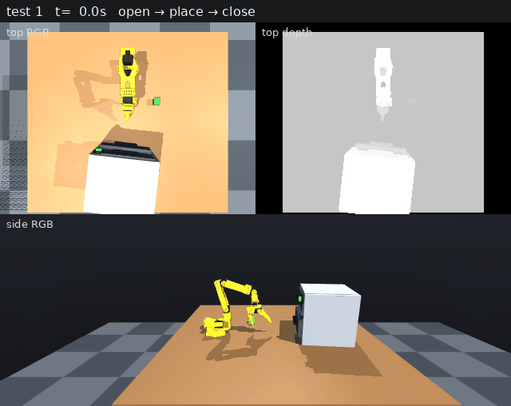
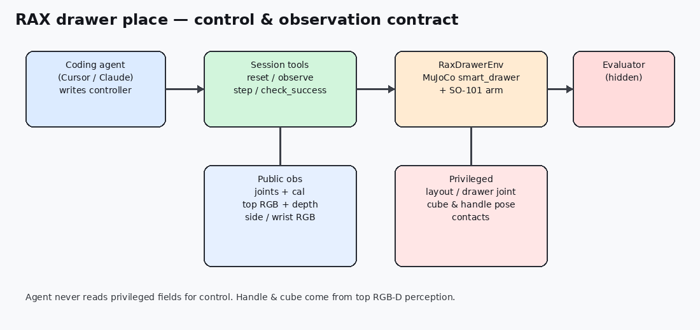
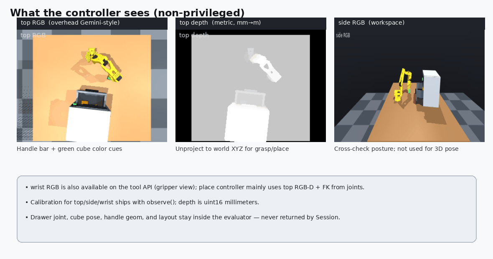
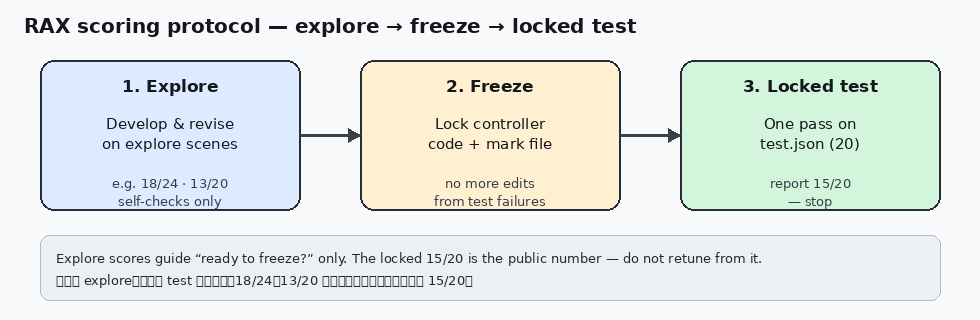
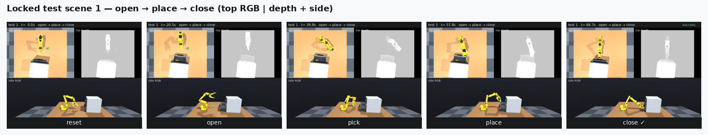
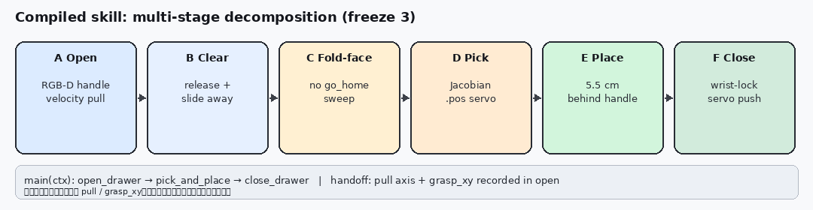
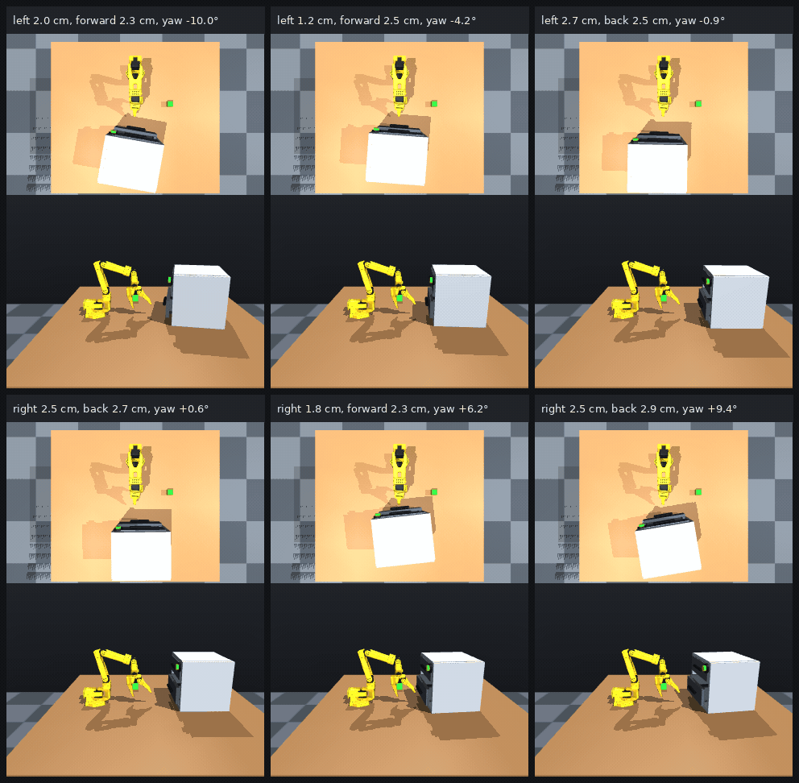

# RAX 开抽屉放方块：SO-101 SimStudio 上的非特权 Agent 控制

> RAX Drawer Place: Non-Privileged Agent Control on SO-101 SimStudio

**语言 / Language:** [中文](#中文) · [English](#english) · ⏱️ ~5 min read

> 📖 想看工具 API、RGB-D 感知、失败复盘与复现命令？ → [**技术详解版 / Deep-dive**](README-details.md)

> 系列上文：[SO-101 SimStudio 项目介绍](../so101-simstudio/README.md) · [Lab 01 抓取放置](../so101-simstudio-lab01-pnp/README.md) · [站上英文版 Lab 01](https://rocpai-forge.github.io/en/posts/so101-simstudio-lab01/)

> 论文 / Paper：[RAX — *Scaling Online Exploration for Robot Agents*](https://arxiv.org/abs/2610.22496) ([project](https://robot-agent-exploration.com))

> **配图：** 图1 全程录像 · 图2 观测契约 · 图3 可见观测 · 图4 评分协议 · 图5 阶段时间条 · 图6 多阶段分解 · 图7 六布局开合



**图 1 / Fig. 1.** 锁定测试场景 1 的全程录像：上排左为俯视彩色、右为俯视深度，下排为侧视。彩色用来认把手和绿方块，深度用来量距离、算三维位置，侧视方便看出机械臂姿态。

---

## 中文

### 先认识 RAX：为何适合长程抽屉任务

[第一篇](../so101-simstudio/README.md)解决 ROCm 上的遥操作与录制；[Lab 01](../so101-simstudio-lab01-pnp/README.md) 打通了示范 → ACT / SmolVLA → 闭环评估。模仿学习很强，但**新本体 / 新长程技能**往往仍要先采一套 teleop 语料；策略也容易被示范分布锁死，难在线上自我改进。

[**RAX**（Robot Agent eXploration）](https://arxiv.org/abs/2610.22496)换了一条轴：**缩放在线探索**。通用编码 Agent 通过机器人感知与控制 API 交互，**不依赖动作示范、手写原语或价值函数**；把成功决策编译成封装「感知—规划—控制」的可执行程序，并在探索中持续修订。论文在仿真与真机、多本体上报告了探索规模与泛化、相对强基线约 **+37.4** 等结果——那些是论文自己的系统研究，**本篇不复现、也不声称验证这些数字**。

我们**借鉴并部分实践**的是其中可迁移到工程课堂的论点与方法：非特权 API 观测（含度量深度）、explore → 编译程序 → freeze → held-out 评测、长程技能拆成可读代码。相对 Lab 01 的 **teleop → 行为克隆**，这对 **开抽屉 → 放方块 → 关抽屉** 这类尚无示范、又要几何接触的任务更对口：

| | Teleop + IL（如 Lab 01） | 本篇借鉴的 RAX 式工作流 |
| --- | --- | --- |
| 前置成本 | 要采够成功示范 | 要探索预算与可调用 API |
| 长程组合 | 示范难覆盖「开—放—关」全序列与恢复 | 可分段试错再合成子技能 |
| 交付物 | 神经网络策略 | 可读、可改的 Python 控制器 |
| 观测契约 | 常与训练相机布局绑定 | 关节 + 相机/**深度**，对齐真机 API 形状 |

**本文定位：** 在 SO-101 SimStudio `labs/rax_drawer/`（已合入 [`main`](https://github.com/rocPAI-Forge/so101-simstudio)）上做一个 **RAX 工作流的可复现切片**——不是论文多本体缩放实验的翻版，而是人 + 编码 Agent 在同一套约束下跑通非特权工具面 → 编译 → freeze → **一次**锁定评测，并报告成绩。

```
explore（工具交互） → compile（Python 控制器） → freeze → locked test（一次）
```

### 非特权观测：相机、深度，而不是抽屉关节

Agent / 控制器**不能**读柜子布局、抽屉关节、方块真值位姿或接触标志。公开观测是关节状态、相机标定、**顶视 RGB + 度量深度**、侧视 / 腕部 RGB。把手与方块必须从顶视 RGB-D 感知出来。

仿真里其实很容易「开挂」：直接读 `drawer_slide`、方块 body 位姿或接触数组，几行代码就能开合。我们**故意不用**这些特权量，是因为真机世界本来就没有它们——只有关节编码器、相机与深度。控制器若在仿真里依赖特权，学到的是作弊捷径，**无法迁到真机**；坚持非特权观测，等于把 sim 管线做成与 real API 同构的形状，给后续 **sim2real**（换 RealSense / Gemini、同一套感知与控制程序）打基础。



**图 2 / Fig. 2.** RAX 抽屉任务的控制与观测契约：编码 Agent 只经 Session 四工具驱动环境；公开观测含关节与相机/深度，布局、抽屉关节、真值位姿等留在隐藏评估器。



**图 3 / Fig. 3.** 控制器实际能看到的非特权观测：俯视彩色、俯视深度、侧视彩色（腕部 RGB 也在 API 中，本 place 程序主要用顶视 RGB-D + 关节）。

### 为何必须认真用深度（仿真与真机同一逻辑）

单靠 RGB 可以认「绿方块 / 黑把手」，却难稳定给出 **世界系 XYZ**——柜子平移、偏航一变，像素尺度就漂。RAX 论文把 **metric depth + 标定** 当作一等公民：Agent 可抬升点云、拟合物体/铰接模型，再在几何上规划抓取与拉开。本 lab 的顶视深度（uint16 毫米 → 米后反投影）扮演同一角色：

- **仿真**：MuJoCo 深度渲染提供干净的度量深度，用来验证「非特权 3D 感知 → 接触控制」管线，而不是偷看 `drawer_slide`。  
- **真机**：RealSense / Gemini 一类深度相机是同一接口形状；噪声更大，但程序仍应对点云与标定负责——这正是 sim→real 可迁移的契约，而不是换一套特权关节读数。

没有深度，开合尚可勉强靠启发式；**放置点相对把手沿拉开方向再进 5.5 cm** 这类要靠真实距离的动作就很难稳。所以 **图 1** 和 **图 3** 才会把深度和彩色并排放：深度不是装饰，而是程序算抓取/放置位置时用到的输入。

### 结果（锁定测试，证据）

| 任务 | 程序 | 锁定 `test.json` |
| --- | --- | --- |
| 仅开合 | `labs/rax_drawer/open_close.py` | **16 / 20** |
| 开 → 放 → 关 | `labs/rax_drawer/rax_place/` freeze 3 | **15 / 20** |

怎么读这些数（RAX 协议）：开发只用 **explore** 场景清单改程序；**test** 是锁死的 20 个未见布局，程序冻结后**只跑一次**，结果不能拿来再调参（否则就是对测试集过拟合）。冻结前我们在 explore 上做了两档自检——前 24 个场景 **18/24**，另外抽 20 个未参与当轮调试的 explore 场景 **13/20**——用来判断「能不能冻」；上表 **15/20** 才是对外报告的锁定成绩（见图 4）。



**图 4 / Fig. 4.** 评分协议：explore 上开发与自检 → 冻结控制器 → 对 `test.json` 只评一次并报告（本实验锁定 15/20），不可用测试失败再调参。



**图 5 / Fig. 5.** 同一成功轨迹的时间切片：reset → open → pick → place → close；每一列仍是俯视彩色|深度 + 侧视。

### 多阶段怎么拆（RAX 编译出的技能）

长程任务不会写成「一步神经网络」。RAX 探索后把经验**编译**成 `main(ctx)` 串联的子技能；阶段之间用手递几何，而不是抽屉关节（见图 6）：



**图 6 / Fig. 6.** 编译技能的多阶段分解（A 开屉 → B 清空 → C 收臂朝向 → D 抓取 → E 放置 → F 关屉）；开屉阶段记下的 `pull` / `grasp_xy` 交给关屉复用。

| 阶段 | 做什么 | 控制方式（摘要） |
| --- | --- | --- |
| **A 开屉** | RGB-D 找下层把手，估水平 `pull` | 速度域靠近 / 夹紧 / 沿 `pull` 拉；**再感知**确认 |
| **B 清空** | 松爪、沿拉开方向让开 | 为抓方块腾出视线与空间 |
| **C 收臂朝向** | **fold-then-face**（禁止直 `go_home`） | 关节位姿两段式，避免扫关抽屉 |
| **D 抓取** | 绿方块质心 → 接近 → 夹紧 | 雅可比 **关节 `.pos`** 伺服；夹爪角过滤空抓 |
| **E 放置** | 把手沿 `pull` **再进 5.5 cm** 下落 | 全程位置域搬运，打开夹爪 |
| **F 关屉** | 侧向抬腕 → **腕锁**对准 → 推回开屉时的 `grasp_xy` | 开屉记下的轴复用到关闭 |

入口与交接见 [`assets/code/controller_stages_snippet.py`](assets/code/controller_stages_snippet.py)；完整感知 / IK / 关屉细节在 [详解版 §4](README-details.md#4-多阶段分解与控制代码freeze-3)。

仅开合在多种柜子平移 / 偏航下的泛化见图 7（顶视 + 侧视网格）：



**图 7 / Fig. 7.** 同一开合程序在六种柜子平移/偏航布局下的表现（每格上为俯视、下为侧视）。

### 从哪里开始

```bash
git clone --recursive https://github.com/rocPAI-Forge/so101-simstudio.git
cd so101-simstudio   # labs/rax_drawer 已在 main
make rocm-sync && source .venv-rocm/bin/activate

./labs/rax_drawer/rax_place/eval_locked.cmd
# 方法说明：labs/rax_drawer/rax_place/RAX_METHOD.md
```

- **代码：** [rocPAI-Forge/so101-simstudio](https://github.com/rocPAI-Forge/so101-simstudio) · lab：[`labs/rax_drawer/`](https://github.com/rocPAI-Forge/so101-simstudio/tree/main/labs/rax_drawer)
- **论文：** [arXiv:2610.22496](https://arxiv.org/abs/2610.22496)
- **技术详解：** [README-details.md](README-details.md)

---

## English

### Meet RAX first: why it fits long-horizon drawers

The [intro post](../so101-simstudio/README.md) covered teleop and recording on ROCm; [Lab 01](../so101-simstudio-lab01-pnp/README.md) closed the imitation loop (demos → ACT / SmolVLA → eval). Imitation learning works well, yet a **new embodiment or long-horizon skill** still usually needs its own teleop corpus, and policies stay bounded by the demonstration distribution.

[**RAX** (Robot Agent eXploration)](https://arxiv.org/abs/2610.22496) scales a different axis: **online exploration**. A general-purpose coding agent interacts through perception and control APIs — **without action demos, hand-engineered primitives, or value-function guidance** — and compiles successful decisions into executable perception–planning–control programs. The paper’s multi-embodiment scaling results (including roughly **+37.4** vs strong baselines) are **its** evidence — **this post does not reproduce or claim to validate those numbers**.

What we **borrow and partially practice** are the parts that transfer to a teaching lab: non-privileged API observations (including metric depth), explore → compile → freeze → held-out eval, and long-horizon skills as readable code. Versus Lab 01’s **teleop → behavior cloning**, that fits **open → place cube → close** when demos are missing and contact geometry matters:

| | Teleop + IL (e.g. Lab 01) | RAX-style workflow (this lab) |
| --- | --- | --- |
| Upfront cost | Enough successful demos | Exploration budget + callable APIs |
| Long horizon | Hard to cover open–place–close + recovery | Stage failures, then compose sub-skills |
| Artifact | Neural policy | Readable, editable Python controller |
| Sensing | Often tied to training camera layouts | Joints + cameras/**depth**; real-API-shaped |

**Positioning:** a **reproducible slice of the RAX workflow** on SO-101 SimStudio `labs/rax_drawer/` (on [`main`](https://github.com/rocPAI-Forge/so101-simstudio)) — not a twin of the paper’s scaling study. Human + coding agent under the same constraints: non-privileged tools → compile → freeze → **one** locked eval, then report the score.

```
explore (tool use) → compile (Python controller) → freeze → locked test (once)
```

### Non-privileged observations: cameras and depth, not the drawer joint

The agent / controller must **not** read cabinet layout, the drawer joint, ground-truth cube pose, or contact flags. Public observations are joint state, calibration, **overhead RGB + metric depth**, and side / wrist RGB. Handle and cube must come from top RGB-D.

Simulation makes cheating easy: a few lines can read `drawer_slide`, the cube body pose, or contact arrays. We **refuse** those privileged fields on purpose. The real world never exposes them — only joint encoders, cameras, and depth. A controller that leans on sim privileges learns a shortcut that **cannot transfer**. Staying non-privileged keeps the sim pipeline isomorphic to a real robot API and is the right foundation for **sim2real** (swap in RealSense / Gemini, keep the same perception and control code).


**Fig. 2** (same as 图 2). Control and observation contract: the coding agent drives the env only through four Session tools; privileged layout / drawer joint / GT poses stay in the hidden evaluator.


**Fig. 3** (same as 图 3). Non-privileged views the controller may use: overhead color, overhead depth, side color.

### Why depth matters (same logic in sim and on real robots)

RGB can label “green cube / dark handle,” but it does not stably give **world XYZ** when the cabinet shifts or yaws. RAX treats **metric depth + calibration** as first-class: agents lift point clouds, fit object / articulated models, and plan grasps and pulls in geometry. Our overhead depth (uint16 mm → meters, then unproject) plays that role:

- **Simulation:** MuJoCo depth rendering supplies clean metric depth so we can validate a non-privileged 3D perception → contact-control pipeline — not by peeking at `drawer_slide`.  
- **Real robots:** RealSense / Gemini-class depth shares the same interface shape; noise is higher, but the program still owns the cloud and calibration — that is the sim→real contract, not a privileged joint readout.

Without depth, open/close can limp along on heuristics; moves that need real distance — such as dropping **5.5 cm behind the handle along the pull axis** — barely hold. That is why **Fig. 1** and **Fig. 3** put depth beside color: depth is a control input for grasp/place geometry, not decoration.

### Results (locked test, evidence)

| Task | Program | Locked `test.json` |
| --- | --- | --- |
| Open/close only | `labs/rax_drawer/open_close.py` | **16 / 20** |
| Open → place → close | `labs/rax_drawer/rax_place/` freeze 3 | **15 / 20** |

How to read the numbers (RAX protocol): develop only on the **explore** scene list; **test** is a frozen set of 20 unseen layouts scored **once** after freeze — you must not retune from those failures (that would be test-set overfitting). Before freezing we ran two explore self-checks — **18/24** on the first 24 scenes, and **13/20** on another 20 explore scenes held out of that tuning pass — only to decide “ready to freeze.” The table’s **15/20** is the reported locked score (see Fig. 4).


**Fig. 4** (same as 图 4). Explore → freeze → one locked test pass; report 15/20 and stop.


**Fig. 5** (same as 图 5). Time strip of one successful episode: reset → open → pick → place → close.

### How the skill is decomposed (what RAX compiled)

The long horizon is not one neural net step. Exploration is compiled into `main(ctx)` sub-skills; stages hand off **geometry**, not the drawer joint (see Fig. 6):


**Fig. 6** (same as 图 6). Multi-stage skill A–F; `pull` / `grasp_xy` recorded at open are reused at close.

| Stage | What | Control (short) |
| --- | --- | --- |
| **A Open** | RGB-D lower handle + horizontal `pull` | Velocity approach / squeeze / pull; **re-perceive** to confirm |
| **B Clear** | Release and slide aside | Free line of sight for the cube |
| **C Fold-face** | **fold-then-face** (no direct `go_home`) | Two joint seeds so the arm does not sweep the tray shut |
| **D Pick** | Green-cube centroid → approach → close | Jacobian **joint `.pos`** servos; gripper angle filters empty grasps |
| **E Place** | Drop **5.5 cm behind** the handle along `pull` | Stay in position mode while carrying; open gripper |
| **F Close** | Pitch away → **wrist-lock** → push to open-time `grasp_xy` | Reuse the recorded pull axis |

Entry / handoff: [`assets/code/controller_stages_snippet.py`](assets/code/controller_stages_snippet.py). Full perceive / IK / close detail: [deep-dive §4](README-details.md#4-多阶段分解与控制代码freeze-3).

Open/close generalization across cabinet shifts / yaws (see Fig. 7):


**Fig. 7** (same as 图 7). Same open/close program on six cabinet layouts (overhead above side in each cell).

### Where to start

```bash
git clone --recursive https://github.com/rocPAI-Forge/so101-simstudio.git
cd so101-simstudio   # labs/rax_drawer is on main
make rocm-sync && source .venv-rocm/bin/activate

./labs/rax_drawer/rax_place/eval_locked.cmd
# method write-up: labs/rax_drawer/rax_place/RAX_METHOD.md
```

- **Code:** [rocPAI-Forge/so101-simstudio](https://github.com/rocPAI-Forge/so101-simstudio) · lab: [`labs/rax_drawer/`](https://github.com/rocPAI-Forge/so101-simstudio/tree/main/labs/rax_drawer)
- **Paper:** [arXiv:2610.22496](https://arxiv.org/abs/2610.22496)
- **Deep-dive:** [README-details.md](README-details.md)
